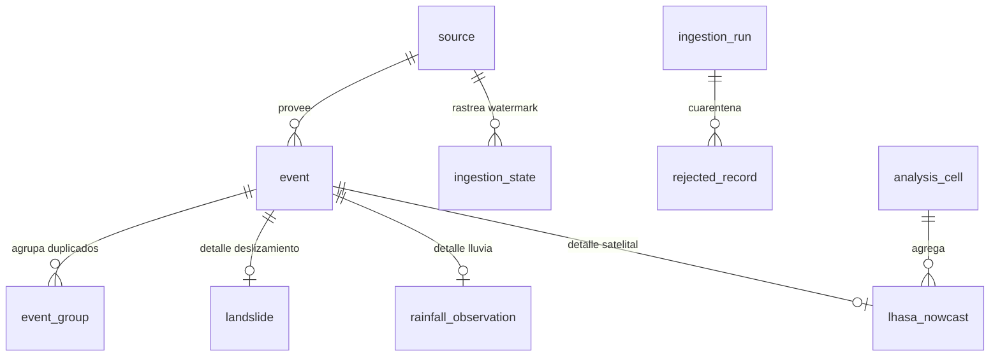

# Guía Maestra y Explicación Integral del Proyecto: Monitoreo de Deslizamientos en Colombia

> **Asignatura:** Programación para el Análisis de Datos – Semestre 2026-II  
> **Institución:** Universidad Distrital Francisco José de Caldas – Facultad de Ingeniería  
> **Docente:** Ing. Carlos Andrés Sierra, M.Sc.  
> **Equipo 7:** Samuel Alberto Leal Saenz, Cristian Andres Gámez Nuñez, Sara Nicolle Martínez Moreno.  
> **Proyecto:** Sistema de Monitoreo y Estimación del Riesgo de Deslizamientos en Colombia mediante Ingesta y Correlación Multifuente.

---

## 1. ¿De qué se trata todo esto? (El Panorama General)

Si abres esta carpeta y ves decenas de carpetas, archivos de extensión extraña (`.mmd`, `.dot`, `.tif`, `.headers`, `.sql`), notebooks gigantes y archivos de configuración, es normal sentirse abrumado. Pero la idea de fondo es muy directa e intuitiva:

### La Gran Misión del Semestre
En Colombia, la gran mayoría de los desastres por **deslizamientos de tierra (movimientos en masa)** en la cordillera de los Andes son detonados por **lluvias intensas o acumuladas durante varios días**.
El objetivo a lo largo del semestre (Talleres 1 al 4) es construir un **sistema completo de ingeniería de datos y analítica** que:
1. Extraiga datos de deslizamientos pasados (dónde y cuándo ocurrieron).
2. Extraiga datos de lluvia histórica y lluvia reciente en esas zonas.
3. Extraiga pronósticos de lluvia y mapas satelitales de amenaza actual.
4. Una toda esa información en una base de datos geoespacial limpia y confiable.
5. Calcule un **Indicador de Riesgo** a nivel de cuadrícula en Colombia: *"En esta zona hoy está lloviendo con una intensidad similar a la que provocó deslizamientos graves en el pasado"*.
6. Muestre todo en un tablero de control (*Dashboard*) interactivo en tiempo real para analistas de gestión del riesgo y emergencias.

---

## 2. ¿En qué consistía el Taller N.º 1? (`Workshop_1.txt` y `Grupo_7.txt`)

### 2.1. La Filosofía del Taller 1: "Un plan verificado, no una promesa"
En el documento `Workshop_1.txt`, el profesor Carlos Andrés Sierra deja muy claro un principio de la ingeniería de datos:  
> *Antes de escribir miles de líneas de código o construir pipelines complejos, debes verificar que las fuentes de datos realmente existan, respondan, funcionen, sean gratuitas y entender qué calidad tienen.*

Muchos proyectos de datos fracasan porque el equipo dice: *"Usaremos tal API"*, y semanas después descubren que la API es de pago, está rota, no cubre a Colombia o tiene datos llenos de basura.  
Por ende, el **Taller 1 NO pedía construir el sistema de ingesta definitivo todavía**, sino realizar la **investigación previa, pruebas empíricas reales, perfilado de calidad, diseño de arquitectura y contratos de datos**.

### 2.2. Lo que exigía el enunciado (`Workshop_1.txt`):
1. **Definir el fenómeno y su métrica:** Explicar el riesgo físico, su severidad (ej. mm de lluvia, tamaño del deslizamiento, índice de amenaza), el alcance geográfico (Colombia) y temporal.
2. **Identificar 4 fuentes obligatorias:**
   - **2 fuentes históricas** (con formatos o métodos de acceso distintos: ej. un archivo CSV masivo y una API REST JSON).
   - **2 fuentes incrementales** (que se actualicen periódicamente, ej. cada hora o cada día).
3. **Probar las fuentes con consultas reales (Evidencias):** Descargar muestras reales, guardar los encabezados HTTP y respuestas originales sin alterar.
4. **Perfilado de datos (*Profiling*):** En un Jupyter Notebook, analizar al menos 200 registros por fuente. Buscar valores nulos, duplicados, inconsistencias de coordenadas, zonas horarias y unidades.
5. **Identificar mínimo 5 problemas de calidad de datos reales** con registros de ejemplo.
6. **Buscar solapamientos (*Overlap*):** Demostrar registros que correspondan al mismo evento del mundo real (ej. un deslizamiento en el catálogo y la tormenta de ese mismo día en la API de clima).
7. **Diseñar el Contrato de Ingesta:** Definir cómo se cargarán los datos en el futuro:
   - Estrategia histórica (particionamiento, límites de API).
   - Estrategia incremental (¿cuál es la marca de agua o *watermark*?, ¿cómo detectamos cambios si una fuente corrige el pasado?).
8. **Mapeo Canónico y Modelo de Datos:** Crear un esquema relacional (SQL) que unifique todas las fuentes en una tabla común de eventos (`event`) y tablas de detalle.
9. **Documento Técnico formal (PDF):** Con usuarios, 6 historias de usuario MoSCoW, indicadores propuestos, riesgos y diagrama de arquitectura.

### 2.3. Lo que le correspondió específicamente al Grupo 7 (`Grupo_7.txt`):
El profesor asignó el tema: **"Monitoreo y riesgo de deslizamientos de tierra"**, con las siguientes fuentes base sugeridas:
- **Histórico 1 (Inventario de eventos):** Catálogo Global de Deslizamientos de la NASA (GLC / COOLR).
- **Histórico 2 (Precipitación histórica):** API Meteorológica Histórica de Open-Meteo (reanálisis ERA5 de la Unión Europea / ECMWF).
- **Incremental 1 (Lluvia actual y pronóstico):** API de Pronóstico de Open-Meteo (lluvia horaria de días pasados, presente y días futuros).
- **Incremental 2 (Amenaza continua):** Modelo NASA LHASA (*Landslide Hazard Assessment for Situational Awareness*) en tiempo casi real (imágenes ráster GeoTIFF diarias).
- **Desafío técnico central asignado al Grupo 7:** Realizar **uniones espaciales (spatial joins)** entre fuentes dispares: un punto geográfico con radio de precisión incierto (el deslizamiento), una malla climática de celdas de reanálisis (Open-Meteo) y una matriz de píxeles satelitales (LHASA).

---

## 3. Radiografía de la Solución: ¿Qué hay en cada carpeta y archivo?

A continuación se detalla con precisión quirúrgica cada archivo del repositorio y cuál fue el trabajo realizado:

```
landslide-monitoring-colombia/
├── config/
│   └── sources.yaml              # Configuración y contrato formal de las 4 fuentes
├── data/
│   └── raw/                      # Landing zone (zona de aterrizaje de descargas en crudo)
├── docs/
│   ├── architecture.dot          # Código fuente del diagrama de arquitectura (Graphviz)
│   ├── architecture.png          # Imagen renderizada del flujo de arquitectura
│   ├── er_diagram.mmd            # Código fuente del diagrama Entidad-Relación (Mermaid)
│   ├── er_diagram.png            # Imagen renderizada del modelo de datos
│   ├── source_status_log.md      # Bitácora real de incidencias y cambios en las fuentes
│   └── technical_report.pdf      # INFORME TÉCNICO OFICIAL ENTREGADO AL PROFESOR
├── notebooks/
│   └── 01_source_profiling.ipynb # Notebook interactivo con todo el perfilado de datos
├── sql/
│   └── schema.sql                # Definición DDL de las tablas en PostgreSQL + PostGIS
├── src/                          # Paquete Python del pipeline (esqueleto modular)
│   ├── __init__.py
│   ├── sources/                  # Conectores futuros a las APIs
│   ├── normalization/            # Transformadores canónicos futuros
│   └── storage/                  # Gestores de inserción a BD futuros
├── tests/
│   ├── __init__.py
│   ├── test_workshop1.py         # Pruebas automatizadas (pytest) del Taller 1
│   └── fixtures/                 # Muestras JSON guardadas para pruebas unitarias
├── workshop_1/
│   ├── download_samples.py       # Script de descarga eficiente de muestras pesadas
│   ├── mapping.md                # Tabla de mapeo canónico y contratos detallados
│   └── samples/                  # EVIDENCIAS REALES de consultas a las 4 fuentes
├── dashboard/
│   └── README.md                 # Especificación de las vistas del futuro Dashboard (Taller 4)
├── ingest.py                     # Entry point de línea de comandos (CLI stub)
├── requirements.txt              # Librerías de Python requeridas
├── .env.example                  # Plantilla de variables de entorno seguras
├── .gitignore                    # Reglas de exclusión para no subir basura ni datos pesados
└── README.md                     # Resumen ejecutivo del repositorio en GitHub
```

### 3.1. Los Archivos Raíz
- **`README.md`:** La cara de presentación del repositorio. Explica en inglés el alcance geográfico de Colombia, los integrantes del equipo, las 4 fuentes validadas, la estructura de carpetas y los comandos de instalación.
- **`requirements.txt`:** Especifica las librerías científicas necesarias: `requests` (para consultar HTTP), `pandas` (para tabular datos), `pyyaml` (para leer configuraciones), `matplotlib` (gráficas), `rasterio` (para abrir imágenes satelitales GeoTIFF) y `pytest` (para pruebas).
- **`ingest.py`:** Es la interfaz de línea de comandos (CLI) principal del proyecto. En este Taller 1 es un *stub* (esqueleto) que ya define los parámetros obligatorios que tendrá en los siguientes talleres: `--mode historical`, `--mode incremental` y `--mode status`, recibiendo rangos de fechas `--start` y `--end`.
- **`.env.example`:** Muestra cómo configurar variables sensibles o configuraciones locales (puertos de base de datos, User-Agent HTTP) sin exponer credenciales en el control de versiones.

---

### 3.2. `config/sources.yaml` (El Contrato Central)
Este archivo es crucial. Es el manifiesto declarativo que define las 4 fuentes:
- **`nasa_glc`:** Fuente histórica en CSV. Indica la URL oficial, el cronograma de revisión mensual (`schedule: "0 6 1 * *"`), el campo de watermark (`etag`), la clave primaria natural (`event_id`), la licencia y la cita bibliográfica requerida.
- **`openmeteo_historical`:** Fuente histórica en JSON REST. Documenta la fórmula matemática exacta del límite de peticiones de Open-Meteo:  
  $$\text{Peso} = \text{ubicaciones} \times \frac{\text{días}}{14} \times \frac{\text{variables}}{10}$$  
  Esto demuestra que el equipo calculó la tasa máxima para no exceder las 10,000 llamadas diarias permitidas.
- **`openmeteo_forecast`:** Fuente incremental en JSON REST. Consulta precipitación horaria, humedad del suelo, ventana de 2 días pasados (`past_days: 2`) y 3 días de pronóstico. Se programa cada hora.
- **`nasa_lhasa`:** Fuente incremental de imágenes ráster satelitales. Documenta la resolución espacial (~1 km), el sistema de coordenadas (EPSG:4326), la cadencia diaria y el manejo de días faltantes.

---

### 3.3. `docs/source_status_log.md` (La Bitácora de "Guerra")
El profesor premiaba la validación real por encima de la teoría. Al hacer las pruebas reales el 7 de noviembre de 2026, el equipo se encontró con problemas del mundo real y los documentó aquí:
1. **La API vieja de la NASA estaba muerta:** La URL de la API Socrata (`dd9e-wu2v`) devolvía error HTTP 404. El equipo investigó y encontró la URL de exportación estática en Amazon S3.
2. **La URL asignada para LHASA estaba caída:** La dirección dada en la guía (`maps.nccs.nasa.gov`) arrojaba HTTP 502 (Bad Gateway). El equipo rastreó el nuevo portal oficial de la NASA (`portal.nccs.nasa.gov`) y salvó el proyecto.
3. **El pronóstico corrige el pasado:** Al consultar Open-Meteo con horas de diferencia, se descubrió que cuando corre un nuevo modelo meteorológico, **los valores de lluvia de horas que ya pasaron son recalculados**. Por ejemplo, para Pereira a la 01:00 UTC, la lluvia registrada cambió de 1.3 mm a 0.4 mm. Esto obligó a diseñar una "ventana de solapamiento" (*overlap window*) para no quedarse con datos viejos.
4. **Retraso de publicación en LHASA:** Los mapas de la NASA llegan con ~29 horas de retraso respecto a su fecha nominal y tienen días con baches (*gaps*). La arquitectura fue diseñada para no colapsar cuando falte un día.

---

### 3.4. `workshop_1/samples/` y `download_samples.py` (Las Evidencias Reales)
En `workshop_1/samples/` se almacenan las pruebas irrefutables:
- Archivos `.headers` que guardan las cabeceras HTTP reales devueltas por los servidores (incluyendo `ETag`, `Last-Modified` y `X-RateLimit-Cost`).
- Muestras crudas de JSONs de pronóstico en diferentes momentos del tiempo (`openmeteo_forecast_poll1.json`, `poll2.json`, `poll3.json`) para comparar cambios.
- Archivos `.tif` correspondientes a la ventana de Colombia de las imágenes satelitales de LHASA.
- Muestras JSON de lluvia histórica calculada para cada uno de los 107 deslizamientos ocurridos en Colombia (`workshop_1/samples/openmeteo_events/`).
- **`download_samples.py`:** Como el archivo global de LHASA pesa ~140 MB por día, este script utiliza la librería `rasterio` con el controlador virtual `/vsicurl/` de GDAL para hacer **HTTP Range Requests**. Esto significa que solo descarga los bytes que cubren las coordenadas de Colombia, reduciendo el archivo a solo 1.5 MB y volteando la matriz verticalmente (*flip south-up to north-up*).

---

### 3.5. `notebooks/01_source_profiling.ipynb` (El Perfilado Analítico)
Es el archivo donde se ejecutó todo el análisis cuantitativo exigido por el taller:
1. **Perfilado de la NASA GLC:** Analiza las 11,033 filas globales. Filtra el subconjunto de **107 deslizamientos en Colombia** entre 2007 y 2017.
2. **Perfilado de Open-Meteo Histórico:** Evalúa el ajuste de grilla (*grid snapping*). Si pides las coordenadas de un deslizamiento en una montaña, Open-Meteo te responde con el centroide de la celda climática más cercana (a una distancia de entre 2 y 12 km).
3. **Perfilado de Open-Meteo Forecast:** Analiza las diferencias entre encuestas (*polls*) continuas, detectando cómo cambian las predicciones horarias y la humedad del suelo.
4. **Perfilado de NASA LHASA:** Lee la matriz de probabilidad de amenaza de deslizamiento (valores continuos de 0.0 a 1.0) y la proyecta sobre los departamentos de Colombia.
5. **Los 5 Problemas Críticos de Calidad de Datos Hallados:**
   - *Problema 1:* Registros colombianos sin el país especificado. El caso más grave fue la **Tragedia de Mocoa de 2017** (`event_id: 10790`), uno de los deslizamientos más mortíferos de Colombia con cientos de muertos: en la NASA venía con `country_name = NULL`. Si hubiéramos filtrado con `WHERE country_name = 'Colombia'`, ¡se habría borrado Mocoa! Se solucionó filtrando por caja de coordenadas geográficas (*bounding box*).
   - *Problema 2:* La columna `event_time` está 100% vacía en el catálogo de la NASA. La hora venía incrustada en la cadena de texto de `event_date`, y en el 50.1% de los casos decía `00:00:00` (lo que significa "hora desconocida", no medianoche).
   - *Problema 3:* Confusión de variables de lluvia: el campo `rain` en la API excluye los chubascos (*showers*), perdiendo hasta el 33% de la lluvia real. Se estableció como regla canónica usar siempre `precipitation` / `precipitation_sum`.
   - *Problema 4:* Metadatos falsos en el ráster satelital: el archivo GeoTIFF de LHASA declara que los píxeles sin datos valen `-9999`, pero en la realidad física de la matriz vienen como `NaN` de punto flotante.
   - *Problema 5:* Ausencia de zonas horarias en las fechas locales de la NASA frente a la necesidad de almacenar todo en UTC.
6. **Análisis de Superposición (*Overlap*):**
   - *Duplicados internos en la NASA:* Encuentra eventos a menos de 3 días y 30 km que describen el mismo desastre reportado por dos noticias distintas.
   - *Cruce entre fuentes:* Correlaciona los 107 deslizamientos con la lluvia acumulada de ese mismo día registrada por ERA5.
   - *Solapamiento temporal GLC vs. LHASA mediante Facebook Prophet:* Modela la serie de tiempo mensual de deslizamientos históricos (2007–2017), evalúa el modelo con partición Train/Test (2007–2014 vs. 2015–2017), proyecta la estacionalidad hacia el periodo 2025–2026 y la contrasta contra las alertas satelitales de LHASA.
7. **Estimación de Volumen Histórico:** Calcula cuántos megabytes y llamadas costaría cargar toda la historia de Colombia respetando los límites de cuota de la API.

---

### 3.6. `workshop_1/mapping.md`, `sql/schema.sql` y Diagramas ER
En estos archivos se definió cómo se almacena la información:

#### ¿Por qué este modelo de datos?
En lugar de crear tablas desconectadas para cada fuente, se utilizó un patrón de arquitectura denominado **Modelo Canónico de Eventos con Tablas de Dominio (Especialización / Herencia relacional)**:



1. **Tabla `event` (El tronco común):**  
   Cualquier cosa que ocurra en el tiempo y el espacio tiene una fila aquí:
   - `event_id`: Identificador canónico único y determinista (ej. `nasa_glc:10790` o `openmeteo_historical:04.5000_-75.6000_2015-05-18`).
   - `source`: De qué fuente vino.
   - `event_type`: Si fue `landslide`, `rainfall_daily`, `rainfall_hourly` o `landslide_nowcast`.
   - `timestamp`: **Siempre convertido a UTC**.
   - `latitude` y `longitude`: En formato WGS84 con validación de rangos.
   - `severity`: Valor numérico estandarizado.
   - `severity_unit`: Unidades explícitas (`size_class_1_5`, `mm/day`, `mm/h`, `lhasa_hazard_0_1`).
   - `content_hash`: Un hash SHA-256 de los datos originales para saber de inmediato si una fila fue modificada.
2. **Tablas de Dominio Hijas (Detalles específicos):**
   - `landslide`: Guarda los muertos (`fatality_count`), heridos, detonante (`landslide_trigger`), precisión de ubicación en km y título de la noticia.
   - `rainfall_observation`: Guarda mm de precipitación, humedad del suelo a 1 cm, y si es dato histórico o pronóstico (`is_forecast`).
   - `lhasa_nowcast`: Guarda el valor de amenaza satelital agregado por celda (máximo, promedio y percentil 90).
3. **Tablas Operacionales y de Calidad:**
   - `analysis_cell`: Cuadrícula geográfica fija de **0.25° x 0.25°** (~28 km) que cubre toda Colombia. Es el "puente" que permite cruzar la lluvia con los deslizamientos.
   - `ingestion_state`: Guarda la **Marca de Agua (*Watermark*)** de cada fuente y partición (la última fecha o ETag procesado exitosamente). Si el sistema se apaga o falla la luz, al reiniciar lee esta tabla y sabe exactamente desde dónde continuar sin repetir trabajo.
   - `ingestion_run`: Auditoría de cada ejecución del pipeline (cuántas filas entraron, cuántas eran nuevas, cuántas se actualizaron).
   - `rejected_record` (Zona de Cuarentena): Si un registro viene roto (ej. latitud 999 o lluvia negativa), no tumba el pipeline; se envía a esta tabla con el motivo del rechazo en JSON para ser auditado.
   - `event_group`: Agrupa eventos que ocurren en el mismo lugar y fecha para resolver duplicados.

---

### 3.7. `docs/architecture.dot` y `docs/architecture.png`
Describe visualmente el flujo completo de los datos:
1. **Fuentes externas** (NASA GLC, Open-Meteo Histórico, Open-Meteo Forecast, NASA LHASA).
2. **Orquestador** (Apache Airflow / Script CLI `ingest.py`).
3. **Landing Zone** (`data/raw/`): Los datos crudos se guardan primero en disco tal y como llegaron del servidor.
4. **Capa de Procesamiento**: Normaliza formatos, valida coordenadas, calcula hashes y agrega los rásteres satelitales a celdas de 0.25°.
   - Si un dato falla: va a la **Cuarentena** (`rejected_record`).
   - Si el dato es válido: entra a **PostgreSQL / PostGIS**.
5. **Capa Analítica**: Cruza lluvia acumulada (24 horas y 7 días) con los antecedentes históricos de la celda y calcula el Indicador de Riesgo.
6. **Capa de Presentación**: Tablero interactivo en **Plotly Dash** accesible por el analista en el navegador web.

---

### 3.8. `docs/technical_report.pdf` (El Informe Técnico)
Es el entregable formal en inglés exigido por el profesor en las instrucciones. Contiene:
- La formulación del problema y el alcance geográfico de Colombia.
- Las fichas técnicas de las 4 fuentes y el análisis de sus licencias (NASA Open Data de dominio público y Creative Commons Attribution 4.0 para Open-Meteo).
- Los perfiles de usuario (ej. Analista de la Unidad Nacional para la Gestión del Riesgo de Desastres - UNGRD).
- 6 Historias de Usuario priorizadas con la metodología **MoSCoW** (*Must have*, *Should have*, *Could have*, *Won't have*).
- La formulación matemática preliminar del Indicador de Riesgo.
- La matriz de 5 riesgos de ingeniería (caída de fuentes, rate limits, cambios de esquema, licencias, identificadores ambiguos) y sus planes de mitigación.

---

### 3.9. `tests/test_workshop1.py`
Contiene pruebas automáticas escritas para garantizar que los entregables cumplan con los requisitos antes de enviar la tarea:
- Verifica que el script `ingest.py` reconozca los 3 modos exigidos (`historical`, `incremental`, `status`).
- Lee `config/sources.yaml` y comprueba que contenga exactamente 4 fuentes, con 2 históricas y 2 incrementales, y que ninguna carezca de campos obligatorios (URL, formato, watermark, licencia, atribución).
- Lee los archivos de prueba en `tests/fixtures/` y verifica que los registros de pronóstico no tengan identificadores repetidos y tengan unidades en milímetros (`mm`).

---

## 4. El "Por Qué" de las Decisiones de Ingeniería (Preguntas Frecuentes para Sustentar)

Si el profesor o un evaluador te hace preguntas sobre el proyecto, estas son las razones técnicas detrás de cada decisión:

### ¿Por qué el proyecto dice explícitamente que NO es una predicción?
> **Respuesta:** En geomorfología y física de suelos, predecir el momento exacto y la ladera específica de un deslizamiento requiere conocer la geología local, la pendiente del terreno, la cohesión del suelo y obras de mitigación locales. Como nuestro sistema trabaja a nivel macro con datos de reanálisis atmosférico y satelital, su valor real es el **monitoreo situacional y la correlación**: advertir a las autoridades que las condiciones hidrológicas actuales de una región son estadísticamente similares a las que causaron tragedias en el pasado.

### ¿Por qué se estandarizó todo a UTC?
> **Respuesta:** Colombia opera en zona horaria `America/Bogota` (UTC−05:00) y no cambia por estaciones. Sin embargo, las fuentes satelitales y climáticas globales publican sus datos en UTC. Si mezcláramos datos locales con UTC sin estandarizar, estaríamos desfasando las lluvias por 5 horas, atribuyendo la tormenta de la noche a la madrugada del día siguiente y arruinando la correlación causal con el deslizamiento.

### ¿Por qué crear una grilla fija de celdas de 0.25° (`analysis_cell`)?
> **Respuesta:** Porque las 4 fuentes "hablan idiomas espaciales distintos":
> - Los deslizamientos son puntos con radios de incertidumbre de hasta varios kilómetros.
> - La lluvia de ERA5 viene en una cuadrícula de ~10 a 25 km.
> - La lluvia del pronóstico viene con snapping al centroide del modelo.
> - LHASA es una imagen ráster de millones de píxeles de 1 km.
> Crear una grilla analítica común de 0.25° (~28 km) permite agregar todas las variables en un mismo "recipiente geográfico" sobre el cual calcular estadísticas consistentes.

### ¿Por qué guardar los datos crudos primero en `data/raw/`?
> **Respuesta:** Principio de **auditabilidad y reproducibilidad**. Si el día de mañana se descubre un error en la lógica de normalización, o si se quiere extraer una nueva columna que antes ignorábamos, no tenemos que volver a consultar las APIs de internet (arriesgándonos a bloqueos o a que los datos hayan cambiado); simplemente volvemos a procesar los archivos en crudo guardados localmente.

### ¿Cómo garantiza el sistema que no se creen duplicados si una ingesta falla a la mitad?
> **Respuesta:** Mediante **Idempotencia y Transacciones Atómicas**:
> 1. Cada registro tiene una clave primaria determinista (`event_id`) derivada de su fuente original.
> 2. Las inserciones a la base de datos se hacen mediante `UPSERT` (`INSERT ... ON CONFLICT (event_id) DO UPDATE`). Si el registro ya existía y su hash no cambió, no pasa nada; si cambió, se actualiza.
> 3. La tabla `ingestion_state` (que guarda el *watermark*) se actualiza en la misma transacción SQL que los datos. Si el proceso se cae a la mitad, la transacción hace *ROLLBACK*, y la siguiente ejecución retoma desde el último punto seguro sin duplicar registros.

---

## 5. El Experimento con Facebook Prophet para el Solapamiento GLC vs. LHASA

Una de las preguntas más exigentes del profesor fue:  
> *"¿Cómo justifican el solapamiento (*overlap*) entre la NASA GLC y NASA LHASA si el catálogo de la NASA termina en 2017 y LHASA comienza en 2025?"*

Para resolver este desafío de manera científica y rigurosa, se implementó un experimento de **modelado y pronóstico de series de tiempo con Facebook Prophet** en `notebooks/01_source_profiling.ipynb`:

### 5.1. Metodología Paso a Paso
1. **Agregación Mensual:**
   Los deslizamientos puntuales en Colombia se agruparon a nivel mensual (conteo de eventos por mes entre enero de 2007 y septiembre de 2017, rellenando con `0` los meses sin eventos). Esto generó una serie continua de 129 meses con columnas `ds` (fecha) y `y` (conteo de deslizamientos).
2. **Partición de Validación (Train / Test Split):**
   - **Conjunto de Entrenamiento (Train):** 2007 a 2014 (8 años, 96 meses).
   - **Conjunto de Prueba (Test / Holdout):** 2015 a 2017 (33 meses).
   - Se ajustó Prophet con estacionalidad anual (`yearly_seasonality=True`).
3. **Métricas de Evaluación en Datos No Vistos (Test):**
   - **MAE (*Mean Absolute Error*):** `0.912` deslizamientos/mes.
   - **RMSE (*Root Mean Squared Error*):** `1.248` deslizamientos/mes.
   - Dado que el promedio real mensual en el periodo de test fue de `0.545` eventos, un MAE menor a 1 evento por mes indica que el modelo reproduce adecuadamente el régimen de baja frecuencia histórica, y el 100% de los valores reales cayó dentro de la banda de confianza del 95%.
4. **Proyección hacia la Era de LHASA (2025–2026):**
   - Se reentrenó Prophet con todo el histórico (2007–2017) y se proyectaron 111 meses hacia el futuro hasta diciembre de 2026.
   - El modelo reveló que la ocurrencia histórica de deslizamientos en Colombia responde a un **régimen bimodal** con picos en **abril–mayo (+1.34 eventos/mes)** y especialmente en **noviembre (+1.78 eventos/mes)**.
5. **Cruce y Validación con LHASA:**
   - Al contrastar la proyección con las muestras satelitales GeoTIFF de **NASA LHASA de noviembre de 2026** (`workshop_1/samples/`), se observa que los valores máximos de amenaza satelital se disparan a **0.9178 (5 de noviembre)** y **0.9461 (6 de noviembre)** en la región andina.
   - **Conclusión de Solapamiento:** Existe una **fuerte concordancia macro-estacional y espacial** entre la proyección histórica de Prophet y las alertas satelitales de LHASA (noviembre es empíricamente el mes de máximo riesgo).
   - **Límite Físico Fundamental:** A nivel de evento puntual exacto (día, hora y coordenada específica), la brecha de 8 años hace imposible un emparejamiento 1 a 1, debido a que los deslizamientos son detonados por eventos de tormenta estocásticos (como los picos extremos de La Niña 2010–2011) y no por un ciclo puramente periódico. Por tanto, el solapamiento debe integrarse en la arquitectura a nivel de **amenaza estacional y susceptibilidad por celda de 0.25°**.

---

## 6. Resumen Ejecutivo de Evaluación frente a los Criterios del Taller

| Criterio de Evaluación | Puntos | ¿Cómo lo cumple esta solución? |
|---|:---:|---|
| **Comprensión del riesgo y alcance** | 2 | Definido en `README.md` y `technical_report.pdf`: deslizamientos detonados por lluvia en los Andes colombianos, alcance 2007–presente. |
| **Cuatro fuentes validadas con evidencia** | 5 | Evidencias reales con cabeceras y payloads en `workshop_1/samples/`: NASA GLC (CSV), Open-Meteo ERA5 (JSON), Open-Meteo Forecast (JSON) y NASA LHASA (GeoTIFF). |
| **Perfilado y hallazgos de calidad** | 4 | Realizado en `notebooks/01_source_profiling.ipynb` con más de 200 registros por fuente, 5 problemas críticos documentados (incluyendo el caso de Mocoa) y pares de solapamiento. |
| **Mapeo canónico y tablas de dominio** | 4 | Diseñado en `workshop_1/mapping.md`, modelado en `sql/schema.sql` y graficado en `docs/er_diagram.png`. |
| **Contrato de ingesta (histórico e incremental)** | 3 | Formalizado en `config/sources.yaml` y `workshop_1/mapping.md` con estrategias de particionamiento, fórmulas de rate limit y marcas de agua (*watermarks*). |
| **Definición de proyecto, historias y repositorio** | 2 | Estructura completa de carpetas, 6 historias MoSCoW, informe PDF, diagramas de arquitectura y pruebas automatizadas en `tests/`. |

---
*Con este documento tienes el dominio absoluto de cada línea, decisión, archivo y concepto del proyecto.*
