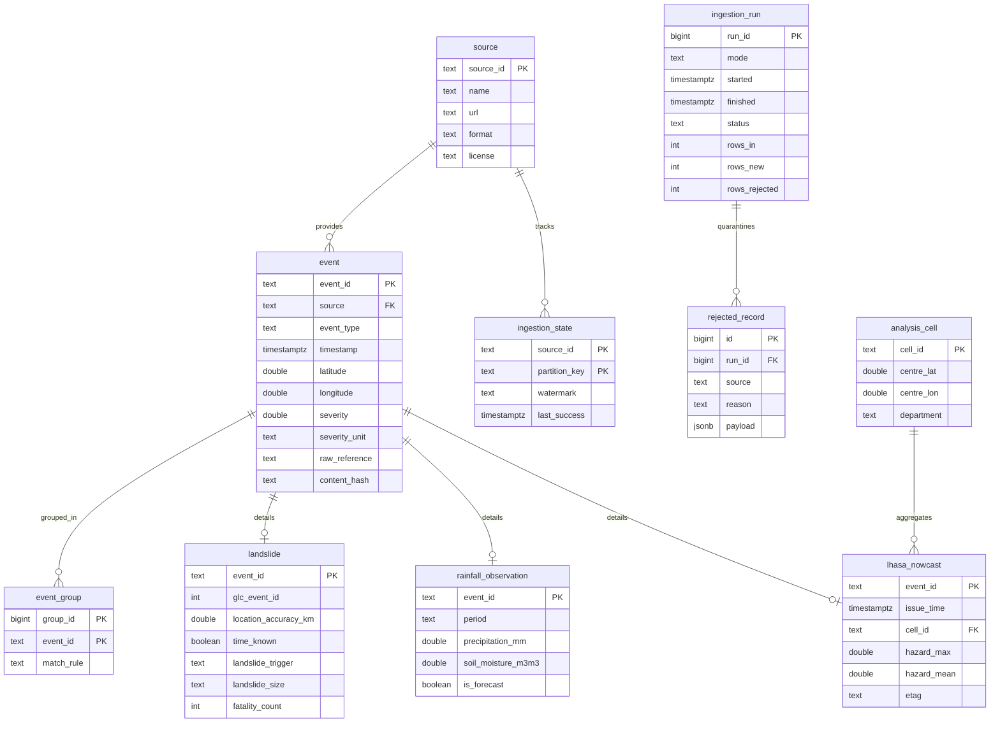

# Canonical Mapping, Domain Tables and Ingestion Contracts

Team 7 — Landslide Monitoring and Risk (Colombia). Workshop #1 draft, 2026-11-07.
All facts about the sources come from the samples in `workshop_1/samples/` and the profiling notebook
`notebooks/01_source_profiling.ipynb`.

## 1. Canonical event model

Every source record becomes one row of `event`:

| Field | Type | Rule |
|---|---|---|
| `event_id` | text, PK | `<source>:<natural key>` (deterministic, so re-runs produce the same id) |
| `source` | text, FK → `source` | One of `nasa_glc`, `openmeteo_historical`, `openmeteo_forecast`, `nasa_lhasa` |
| `event_type` | text | `landslide`, `rainfall_daily`, `rainfall_hourly`, `landslide_nowcast` |
| `timestamp` | timestamptz (UTC) | Start of the observation or the event time, converted to UTC |
| `latitude`, `longitude` | double, WGS84 decimal degrees | Range-checked: lat ∈ [−90, 90], lon ∈ [−180, 180]; scope filter = Colombia bbox |
| `severity` | double | Numeric severity of the record (unit depends on `event_type`, see below) |
| `severity_unit` | text | `size_class_1_5`, `mm/day`, `mm/h`, `lhasa_hazard_0_1` |
| `raw_reference` | text | Original id or request URL + raw file name in `data/raw/` |
| `content_hash` | text | SHA-256 of the normalized source record; used for change detection |

## 2. Field mapping per source

### 2.1 NASA Global Landslide Catalog (`nasa_glc`)

| Canonical field | Source field | Transformation |
|---|---|---|
| `event_id` | `event_id` | `nasa_glc:<event_id>` (integer, unique in the export: 0 duplicates) |
| `event_type` | — | constant `landslide` (`landslide_category` goes to the domain table) |
| `timestamp` | `event_date` | Parse `%m/%d/%Y %I:%M:%S %p`; the value is local time (Colombia UTC−05:00, no DST) → add 5 h to obtain UTC. If the time is exactly 00:00 (50.1 % of rows), keep the date and set `landslide.time_known = false`. `event_time` is 100 % empty and is ignored. |
| `latitude`, `longitude` | `latitude`, `longitude` | Direct (no invalid or (0,0) values found) |
| `severity` | `landslide_size` | Ordinal: small = 1, medium = 2, large = 3, very_large = 4, catastrophic = 5; `unknown`/empty → NULL |
| `raw_reference` | `source_link` | Plus the raw file name |

Scope filter: Colombia bounding box **and** (`country_name = 'Colombia'` or `country_name` empty and the point falls
inside the Colombian boundary). Filtering by `country_name` alone loses 6 of 107 Colombian events (e.g., Mocoa 2017).

### 2.2 Open-Meteo Historical Weather API (`openmeteo_historical`)

| Canonical field | Source field | Transformation |
|---|---|---|
| `event_id` | `latitude`, `longitude` (returned), `daily.time` | `openmeteo_historical:<lat 4 dp>_<lon 4 dp>_<YYYY-MM-DD>` |
| `event_type` | — | `rainfall_daily` |
| `timestamp` | `daily.time` | Requested with `timezone=America/Bogota` so the day matches the local GLC date; stored as the start of the local day in UTC (`YYYY-MM-DDT05:00Z`) |
| `latitude`, `longitude` | returned `latitude`, `longitude` | Use the **returned grid cell**, not the requested point (offset 2–12 km in the sample) |
| `severity` | `daily.precipitation_sum` | mm/day (unit read from `daily_units`) |
| `raw_reference` | request URL | Plus the raw file name |

### 2.3 Open-Meteo Forecast API (`openmeteo_forecast`)

| Canonical field | Source field | Transformation |
|---|---|---|
| `event_id` | returned lat/lon, `hourly.time` | `openmeteo_forecast:<lat>_<lon>_<YYYY-MM-DDTHH>` |
| `event_type` | — | `rainfall_hourly` |
| `timestamp` | `hourly.time` | Requested with `timezone=UTC`; ISO 8601 without offset → interpreted as UTC |
| `latitude`, `longitude` | returned lat/lon | Grid cell |
| `severity` | `hourly.precipitation` | mm/h (preceding hour sum) |
| `raw_reference` | request URL | Plus raw file name |

Hours later than the poll time are forecasts: they are stored with `rainfall_observation.is_forecast = true` and are
overwritten when the hour becomes past.

### 2.4 NASA LHASA nowcast (`nasa_lhasa`)

The raster has 722,571 valid pixels (≈1 km) per day for the Colombia window, so it is aggregated before reaching
`event`: one row per **0.25° analysis cell** and issue time (782 cells with values in the bounding box).

| Canonical field | Source field | Transformation |
|---|---|---|
| `event_id` | file name, cell id | `nasa_lhasa:<YYYYMMDDTHHMM>_<cell_id>` |
| `event_type` | — | `landslide_nowcast` |
| `timestamp` | file name `YYYYMMDDTHHMM` | Nominal issue time, already UTC |
| `latitude`, `longitude` | — | Centre of the analysis cell |
| `severity` | pixel values | Maximum hazard value inside the cell (dimensionless, 0–1). NaN pixels ignored. |
| `raw_reference` | file URL | Plus `ETag` and `Last-Modified` |

Before aggregation: read the window with range requests, flip the south-up raster to north-up, and treat `NaN` as
missing (the declared `nodata = −9999` never occurs).

## 3. Domain tables

| Table | Columns | Notes |
|---|---|---|
| `landslide` | `event_id` (PK, FK → event), `glc_event_id`, `title`, `location_description`, `location_accuracy_km`, `time_known`, `landslide_category`, `landslide_trigger`, `landslide_size`, `landslide_setting`, `fatality_count`, `injury_count`, `country_name`, `admin_division_name`, `source_name`, `source_link`, `last_edited_date` | `location_accuracy_km`: `exact` → 0, `Nkm` → N, `unknown`/empty → NULL |
| `rainfall_observation` | `event_id` (PK, FK), `cell_lat`, `cell_lon`, `elevation_m`, `period` (`daily`/`hourly`), `precipitation_mm`, `rain_mm`, `precipitation_hours`, `soil_moisture_m3m3`, `is_forecast`, `dataset` (`era5_archive`/`forecast`) | Soil moisture only from the forecast API |
| `lhasa_nowcast` | `event_id` (PK, FK), `issue_time`, `file_name`, `cell_id`, `hazard_max`, `hazard_mean`, `hazard_p90`, `valid_pixels`, `etag`, `last_modified` | |
| `analysis_cell` | `cell_id` (PK), `min_lat`, `min_lon`, `max_lat`, `max_lon`, `centre_lat`, `centre_lon`, `department` | Static 0.25° grid used to join all sources and to report the indicator |

Common tables (from the course data model): `source`, `ingestion_run`, `ingestion_state`, `event`,
`event_group`, `rejected_record`.

## 4. Normalization rules

- **Time:** all timestamps stored in UTC (`timestamptz`). Local Colombian times → UTC by adding 5 hours (UTC−05:00 all
  year). Dates without a known time keep the date and set `time_known = false`.
- **Coordinates:** WGS84, decimal degrees, 6 decimal places. Open-Meteo records use the returned grid coordinates.
- **Units:** precipitation in mm (Open-Meteo already returns mm, checked through `*_units`); soil moisture in m³/m³;
  LHASA dimensionless 0–1; location accuracy converted to km.
- **Precipitation field:** always `precipitation` / `precipitation_sum`, never `rain`. In the forecast API `rain`
  excludes showers (it was 33 % of total precipitation in the sample); in the archive both fields are equal.
- **Severity:** always numeric with an explicit `severity_unit`; scales are not mixed in calculations across event types.
- **Validation (rejected → `rejected_record`):** missing id or timestamp, coordinates out of range, negative
  precipitation, LHASA value outside [0, 1], unit different from the expected one.

## 5. Ingestion contracts

| | NASA GLC | Open-Meteo historical | Open-Meteo forecast | NASA LHASA |
|---|---|---|---|---|
| **Access** | One CSV (8.5 MB), URL redirects to a pre-signed S3 link | REST JSON, multi-location | REST JSON, multi-location | Directory listing + one GeoTIFF per issue time |
| **Historical strategy** | Single download, no pagination; keep the global file in `data/raw/`, filter to Colombia in normalization | Partition by group of points × year; weight per request = locations × days/14 × variables/10 (verified with `X-RateLimit-Cost`); stay under 600/min, 5,000/h, 10,000/day; resume from `ingestion_state` per partition | Not used for history | Optional: available archive since 2025-01-01, ~1.5 MB per file for Colombia |
| **Incremental strategy** | Frozen since 2017 (file `Last-Modified` 2025-05-29). Monthly check of `ETag`; if it changes, reload and upsert by `event_id`, comparing `content_hash` | Monthly extension of each cell up to the last available date | Poll every hour; hourly values change only with new model runs, `current` every 15 min | Poll the listing once a day at 06:30 UTC (files appeared at ~05:07 UTC, ≈29 h after nominal time) |
| **Watermark** | `ETag` of the file | Last `date` loaded per cell | Last past hour (`time ≤ poll time`) per cell | Last processed issue time (from file name) |
| **Overlap window** | Whole file | Last 10 days re-requested | Re-request `past_days=2`, upsert rows whose hash changed (revisions) | Re-list the last 7 days; re-process a file if its `ETag` changed |
| **Duplicate key** | `event_id` of the source (stored as `landslide.glc_event_id`) | (cell lat, cell lon, date) | (cell lat, cell lon, hour) | (issue time, cell id) |
| **Revisions / deletions** | Rows edited (`last_edited_date`) → hash change; rows missing in a new export → flag as withdrawn, never hard-delete | Recent days may be revised → overlap window | Past hours revised by new runs → overlap window | Missing days are normal (17 gaps since 2025); republished files detected by `ETag` |

**Failure safety (all sources):** (1) the raw response is written to `data/raw/` first; (2) each partition is
loaded in one database transaction with upserts on the duplicate key; (3) the watermark in `ingestion_state` is
updated in the same transaction, only after the data commit. If a run stops halfway, the next run starts from the
last committed watermark and the upserts make the repeated rows harmless.

**Sample settings vs. contract settings.** The Workshop #1 samples were requested with wider windows to observe
the sources (forecast: `past_days=7`, plus a `daily` block; 10-city historical sample: `timezone=UTC`). The
contract values above (`past_days=2`, hourly only, `timezone=America/Bogota` for daily history) are the ones the
pipeline will use; the 107 antecedent-rainfall samples were already requested with `America/Bogota`.

A draft DDL of these tables is in `sql/schema.sql`.

## 6. Entity-relationship diagram (draft)

